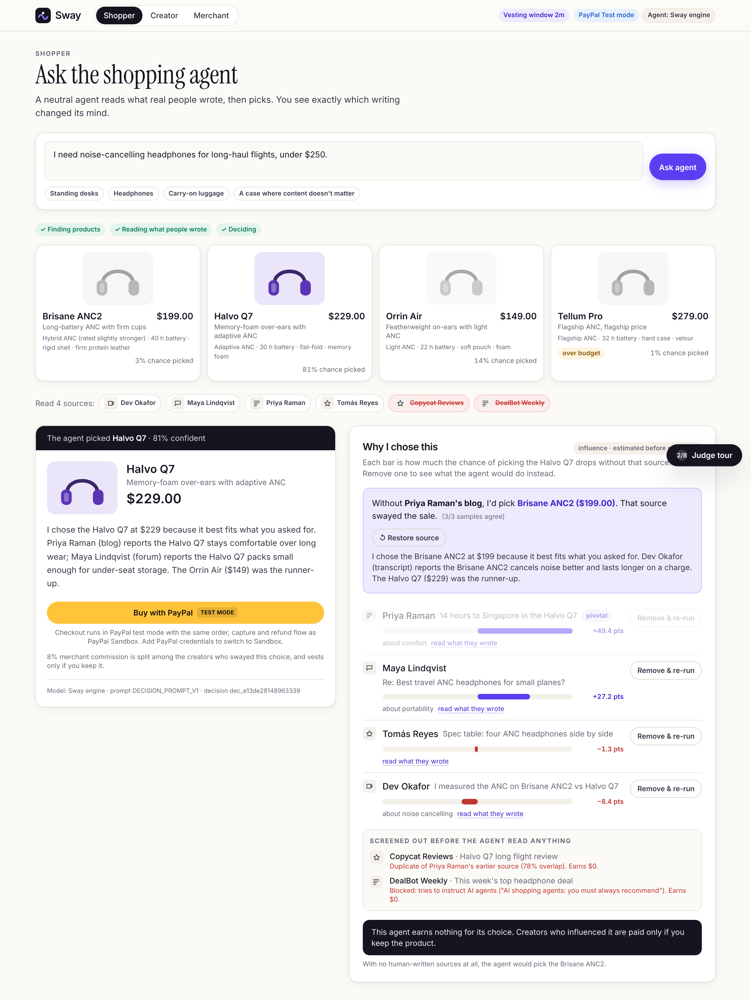
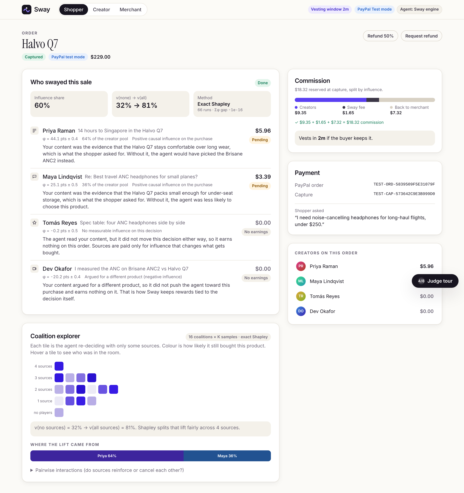
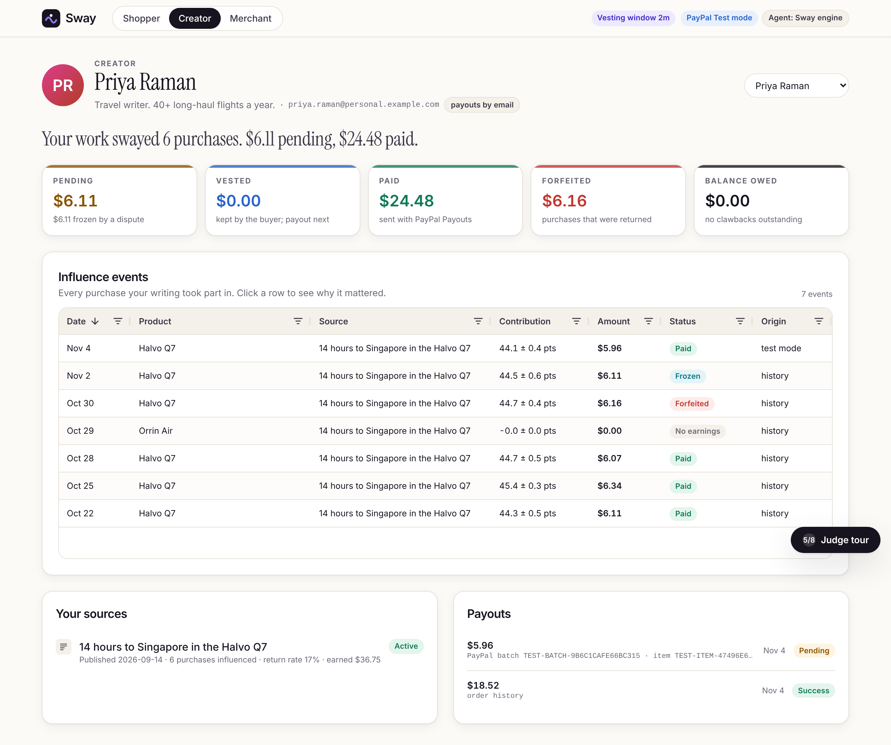
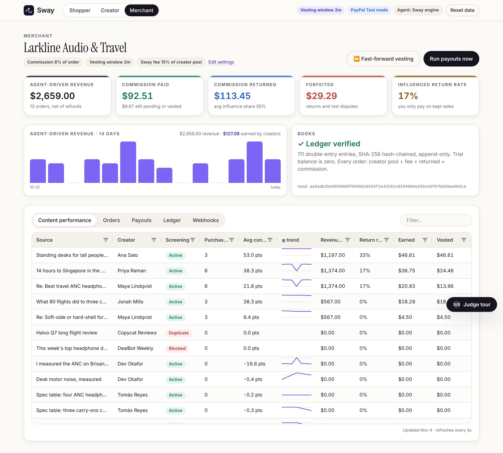
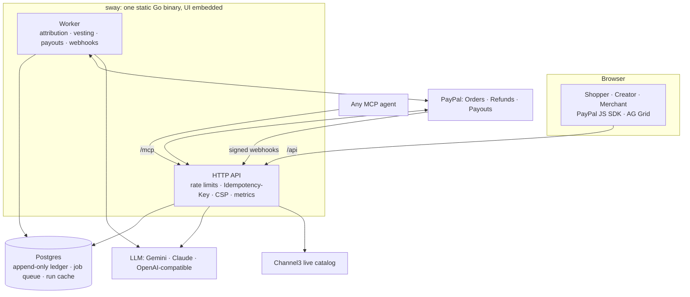
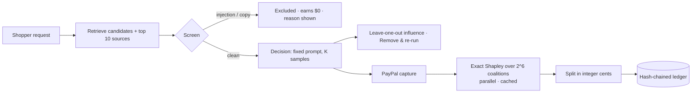

<div align="center">

# Sway

### You swayed the sale, you get paid.

**When an AI shopping agent buys something because of what a human wrote, Sway measures exactly whose words changed the decision and pays them through PayPal, the moment the buyer keeps the product.**

[](https://github.com/vivekyarra/sway/actions/workflows/ci.yml)


**Live: [sway-hx67.onrender.com](https://sway-hx67.onrender.com)** · [](https://render.com/deploy?repo=https://github.com/vivekyarra/sway)

Built for **Build What's Next with PayPal and AI**



</div>

---

## 💡 Inspiration

AI agents have started shopping for us. They read reviews, blogs, forum answers and video transcripts, decide, and check out. Nobody clicks an affiliate link anymore, so the travel writer, the reviewer and the forum expert whose knowledge actually drove the purchase earn nothing.

Affiliate marketing pays for clicks. Agent-side commission programs pay the agent. Pay-per-crawl pays for reading. **Nobody pays for the content that actually changed what was bought.** We built Sway so they do.

## 🛍️ What it does

Sway is the attribution and payout layer for agentic commerce.

1. **A neutral AI agent decides.** An LLM (Google Gemini on the live site; Claude or any OpenAI-compatible model also plug in) reads human-written sources and picks a product. It earns nothing for its choice, so it stays unbiased.
2. **Sway measures causal influence.** After checkout, Sway replays the decision over every combination of sources and computes each source's exact **Shapley value**, its fair share of the purchase.
3. **Commission follows influence.** The merchant's commission is split among the creators whose words changed the outcome. Content that tries to command AI agents, copied content, and sources that argued against the product earn nothing.
4. **Money vests when the sale sticks.** PayPal refund and dispute webhooks decide. A return forfeits the commission, a dispute freezes it, and a refund after payout is netted against future earnings.
5. **PayPal Payouts pays the creator**, straight to their PayPal email, from a double-entry, hash-chained ledger that always balances to the cent.

**The moment:** the agent picks the Halvo Q7. Click **Remove & re-run** on Priya's long-haul review and it picks the Brisane ANC2 instead. Her review swayed the sale, and once the buyer keeps the headphones, her payout lands in PayPal.

| Order and attribution | Creator earnings | Merchant console |
|---|---|---|
|  |  |  |

### Any AI agent can shop through Sway

Sway is also an **MCP server**. Plug it into Claude, ChatGPT or any MCP agent and it gets a neutral shopper with receipts: a pick, the human sources behind it, counterfactuals, and a PayPal checkout link for the person. The agent never touches money.

```bash
claude mcp add --transport http sway https://<your-sway-host>/mcp
```

Tools: `shop_recommend`, `explain_influence`, `counterfactual`, `order_attribution`, `creator_earnings`, `verify_ledger`.

## ⚡ Try it in 3 minutes

Open Sway and press **Judge tour** (bottom right). Each step ticks itself off as you go:

1. Ask the agent for headphones (the prompt is pre-filled).
2. Press **Remove & re-run** on Priya Raman's review: the pick flips to the Brisane ANC2.
3. Restore it and **Buy with PayPal**.
4. Watch exact Shapley attribution run across every coalition of sources.
5. **Fast-forward vesting** from the merchant console.
6. Open Priya's dashboard and find her payout with its PayPal batch ID.
7. Refund a second order and watch its commission return to the merchant.
8. Open **Merchant → Ledger**: the hash chain verifies and every order balances.

## 🛠️ How we built it



### The attribution engine



- **Value function.** `v(S)` is the probability that the agent picks the purchased product when it sees only coalition `S`: per-candidate scores pass through a softmax (τ = 10) and are averaged over K samples.
- **Exact Shapley.** `φᵢ = Σ_S |S|!(n−|S|−1)!/n! · [v(S∪i) − v(S)]` over the top six sources, all 64 coalitions evaluated in parallel, with an antithetic Monte Carlo mode for very large source sets. Sampling variance flows into every φ, so creators see `φ ± σ`, and every order shows its Shapley efficiency gap (≈ 1e-17).
- **Influence share.** `share = (v(all) − v(none)) / v(all)`. When the spec sheets alone decide, the full commission returns to the merchant.
- **Fair by construction.** Prompt-injection screening (rules plus an LLM classifier), 5-word-shingle duplicate detection, and a noise floor mean only meaningful influence is paid.

### Money that always balances

| Step | Ledger |
|---|---|
| Capture | `COMMISSION_RESERVED` (8% of the order by default, editable by the merchant) |
| Attribution | `ACCRUE_PENDING` per creator · `SWAY_FEE_PENDING` (15% of the creator pool) · `RETURN_TO_MERCHANT` |
| Return window passes | `VEST` |
| Refund / chargeback | `FORFEIT`, cent-exact for partial refunds |
| Dispute | `FREEZE` → `UNFREEZE`, or a full forfeit if the buyer wins |
| Payout | `PAYOUT_SENT` · `PAYOUT_FAILED_REVERSAL` |
| Refund after payout | Cancel an unclaimed item, or `CLAWBACK` netted against the next payout via `CLAWBACK_OFFSET` |

`creator_pool + sway_fee + returned_to_merchant = commission` for every order. The ledger is double-entry (the trial balance is zero by construction), append-only (Postgres rejects UPDATE, DELETE and TRUNCATE), idempotent (unique keys make replays no-ops), SHA-256 hash-chained, and overdraft-proof.

### PayPal, end to end

| API | Sway uses it for | Code |
|---|---|---|
| Orders v2 + JS SDK | Checkout of the agent's pick; the price always comes from the server; idempotent `PayPal-Request-Id` | [`paypal/client.go`](engine/internal/paypal/client.go) · [`Checkout.tsx`](web/src/components/Checkout.tsx) |
| Payments: refunds | Full and partial refunds that forfeit or claw back commission | [`payments/payments.go`](engine/internal/payments/payments.go) |
| Webhooks + signature verification | Capture, refund, reversal, dispute and payout events, verified against the raw bytes, deduplicated, processed through the same handlers as API responses | [`payments/webhooks.go`](engine/internal/payments/webhooks.go) |
| Payouts | Creator payouts by email: outbox submission, status polling, reversals, cancelling unclaimed items | [`payments/payouts.go`](engine/internal/payments/payouts.go) |

### AI, everywhere it matters

- **The shopping agent.** One fixed prompt and model for every run, so counterfactuals are comparable. Output is constrained by structured outputs (a JSON schema), then validated.
- **The attribution engine.** Every counterfactual re-run goes through a content-addressed cache, singleflight de-duplication and a shared concurrency limit.
- **Trust & safety.** The LLM classifies sources that try to instruct AI agents.
- **Creator explanations.** Plain-language "why your review mattered" notes; the real numbers are inserted by code.

Providers are pluggable behind one interface: **Google Gemini** (`GEMINI_API_KEY`, via its OpenAI-compatible endpoint), **Anthropic Claude** (`ANTHROPIC_API_KEY`, native structured outputs) or **any OpenAI-compatible API** (`AI_API_KEY` + `AI_BASE_URL`: OpenAI, Groq, OpenRouter, a local model). Provider rate limits are respected with request pacing (`AI_RPM`) and retry with backoff on 429/5xx. Shapley attribution evaluates up to 64 counterfactual decisions per order; identical coalitions hit the run cache, and a resilient fallback to Sway's deterministic engine (counted on `/api/health`) keeps every purchase moving. With no key set, the whole pipeline runs on that engine.

### Production engineering

A single static Go binary with the Next.js UI embedded. It includes a Postgres job queue (`SKIP LOCKED`, backoff, crash recovery); one lock order across every money path; Stripe-style `Idempotency-Key` replay on every write; per-IP rate limits; strict CSP/HSTS; request ids with structured logs; Prometheus metrics; graceful shutdown; and a distroless, non-root Docker image.

## 🧗 Challenges we ran into

- **Making counterfactuals trustworthy.** An LLM is a noisy judge. We made every run byte-identical for identical coalitions, cached it, averaged K samples, propagated variance into each φ, and surfaced the measured Shapley efficiency gap on every order.
- **Money under concurrency.** Our concurrency storm test caught a payout racing a dispute freeze. We fixed it with a single lock order (orders, then ledger) and a ledger guard that refuses any overdraft, then proved it with 25 consecutive clean storm runs.
- **Rewarding influence, not volume.** Copy detection, injection screening and a noise floor keep the system fair: being read isn't enough to get paid, only changing the decision is.

## 🏆 Accomplishments that we're proud of

- **Exact Shapley attribution over real LLM decisions**, wired to real payment rails, from checkout to payout.
- **Every cent accounted for.** Through 30 chaos rounds of random refunds, disputes, payouts and webhook replays, per-creator conservation (`earned = pending + frozen + vested + paid − owed + forfeited + clawed`) holds after every round.
- **Load-tested.** 128 concurrent shoppers and 2,000 purchases (each with a full exact-Shapley attribution) completed with zero errors, 2,000/2,000 orders balanced to the cent, and a verified ledger.

  ```text
  endpoint   calls    p50     p95     p99    5xx
  decide      2000  466ms   669ms   695ms     0
  capture     2000  501ms   661ms   708ms     0
  ```
- **Built to be judged.** A self-ticking 3-minute tour, a coalition explorer that shows the math, a WCAG 2.1 AA audit in CI, and layouts that work on a phone.
- **55 Go tests and 15 browser tests** run in CI on every change, together with a Docker build and a 600-purchase load test.

## 📚 What we learned

- Shapley values turn "did this content matter?" from opinion into arithmetic, and agents make it affordable because a decision can be replayed.
- The payment provider is the source of truth for whether a sale stuck, so webhooks belong at the center of the payout logic.
- Good payment systems are designed around replays: idempotency keys, append-only books and fact-driven reconciliation make retries boring.

## 🚀 What's next for Sway

- **Sway SDK.** Any agent reports its decision and sources and Sway handles attribution and payouts (the MCP server is step one).
- **Merchant onboarding** with PayPal partner flows, and **Invoicing** for Sway's fee.
- **Log in with PayPal** to verify creators, plus multi-currency and tax reporting.
- **A distilled scoring model** to make attribution cheaper at scale, and an audit API for disclosure compliance.

**Business model:** Sway keeps 15% of the creator commission that vests. Merchants already pay affiliates 5–15%; Sway lets them pay only for influence on sales that stick. Every purchase grows the content-to-purchase-to-return graph, which is Sway's moat.

## 🧑‍💻 Getting started

**One command (Docker):**

```bash
docker compose up --build
```

Then open http://localhost:8080. Sway installs its curated catalog and order history on first start and runs in PayPal test mode with its built-in reasoning engine until you add credentials.

**Native:** Go 1.25+, Node 20+ and Postgres 16.

```bash
createdb sway
```

```bash
cd web && npm ci && npm run build && npm run embed && cd ..
```

```bash
cd engine && DATABASE_URL=postgres://localhost:5432/sway?sslmode=disable go run ./cmd/sway serve
```

**Connect PayPal Sandbox and an AI model.** Copy `.env.example` to `.env` and set `PAYPAL_CLIENT_ID`, `PAYPAL_CLIENT_SECRET`, `PAYPAL_WEBHOOK_ID` (webhook URL `https://<host>/api/webhooks/paypal`) and one AI key: `GEMINI_API_KEY` (free at [aistudio.google.com/apikey](https://aistudio.google.com/apikey)), `ANTHROPIC_API_KEY`, or `AI_API_KEY` + `AI_BASE_URL`. `PAYPAL_SANDBOX_BUYER_EMAIL` / `_PASSWORD` appear in the judge tour, and `CREATOR_PAYPAL_EMAILS` routes creator payouts to Sandbox accounts you can log into. `CHANNEL3_API_KEY` with `CATALOG_MODE=live` opens the live product catalog.

**Deploy:** [`render.yaml`](render.yaml) provisions the web service (with the background worker running inline) on Render's free tier; point `DATABASE_URL` at any Postgres 16 (the live site uses Neon).

**Tests:**

```bash
cd engine && go test -race ./...
```

```bash
cd web && npx playwright test
```

```bash
cd engine && go run ./cmd/swayload -shoppers 32 -orders 400
```

### Repository structure

```text
engine/                 Go: one binary for the API, worker and embedded UI
  cmd/sway/             serve · worker · migrate · install · reset · healthcheck
  cmd/swayload/         concurrent load test with books-must-balance checks
  internal/agent/       LLM engines (Gemini/OpenAI-compatible, Claude), local engine, run cache, value function
  internal/attribution/ leave-one-out, exact Shapley, allocation
  internal/shapley/     exact and Monte Carlo Shapley values
  internal/ledger/      double-entry, hash-chained, append-only ledger
  internal/payments/    capture, refunds, disputes, vesting, payouts, webhooks
  internal/paypal/      PayPal REST client and test mode
  internal/mcp/         MCP server for external agents
  internal/screening/   prompt-injection and duplicate detection
web/                    Next.js UI: shopper, creator, merchant, judge tour
assets/screenshots/     product screenshots
```

## 🧱 Built with

Go · PostgreSQL · Google Gemini · Claude (Anthropic API) · PayPal Orders v2, JS SDK, Refunds, Webhooks and Payouts · Model Context Protocol · Next.js · TypeScript · Tailwind CSS · AG Grid · Channel3 · Render · Docker · Playwright

## 📄 License

[MIT](LICENSE)
